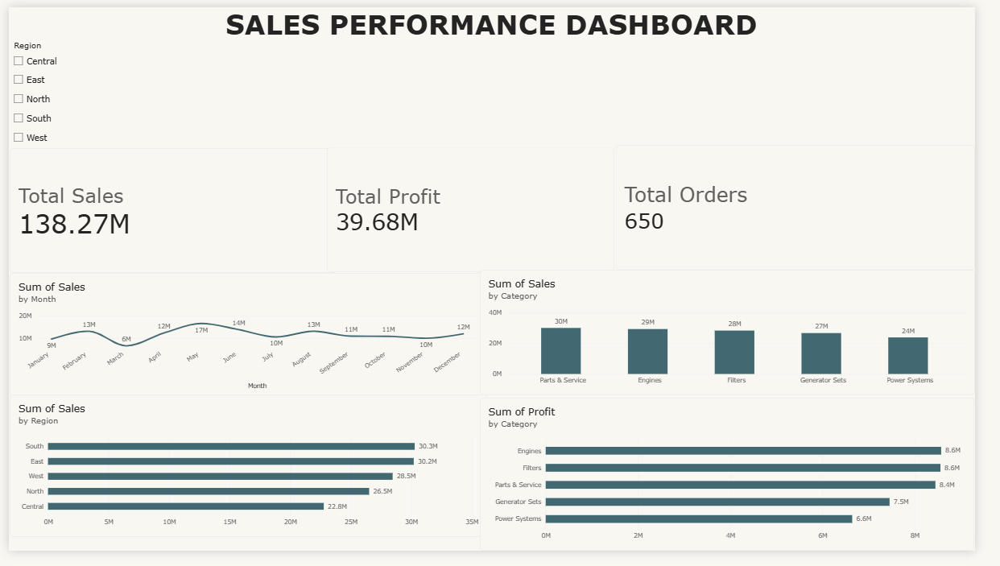
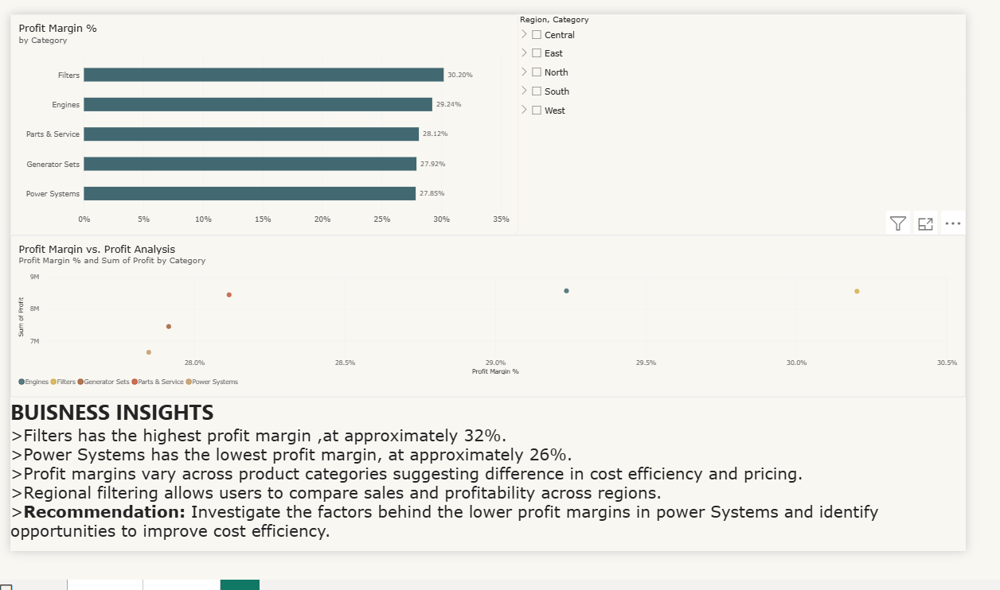

# 📊 Sales Performance Dashboard | Power BI

An interactive Power BI dashboard built to analyze sales performance, profitability, and regional trends using a simulated sales dataset.

## 🎯 Project Objectives

* Monitor key performance indicators (KPIs), including total sales, total profit, and total orders.
* Analyze monthly sales trends.
* Compare sales performance across product categories and regions.
* Evaluate profitability and profit margins.
* Enable interactive exploration using regional filters.

## 🛠️ Tools & Technologies

* **Power BI Desktop** — Dashboard development and data visualization
* **DAX** — Measures and KPI calculations
* **CSV** — Dataset storage and input

## 📈 Dashboard Preview

### Sales Overview



### Profitability Analysis



## 📂 Repository Structure

```text
Sales-Performance-Dashboard/
├── dashboard/
│   └── Sales_Performance_Dashboard.pbix
├── dataset/
│   └── sales_performance_dataset.csv
├── screenshots/
│   ├── page1.png
│   └── page2.png
└── README.md
```

## 🔍 Key Analysis Areas

* Sales and profit performance
* Monthly sales trends
* Category-wise sales and profitability
* Regional comparisons
* Profit margin analysis

## 📊 Dataset

This project uses a **simulated dataset created for learning and portfolio purposes**. It does not contain actual company or customer sales records.

## 🚀 How to Explore

1. Download the `.pbix` file from the `dashboard` folder.
2. Open it using Power BI Desktop.
3. Use the dashboard filters and visuals to explore the data.

## 👨‍💻 Project Purpose

Created as a portfolio project to demonstrate skills in business intelligence, data visualization, KPI reporting, and exploratory business analysis.

